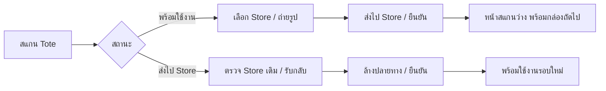

# คู่มือหน้างาน

## เริ่มกะ

เปิดเว็บจาก TC22 → กรอกชื่ออย่างน้อย 3 ตัวอักษรเพื่อเลือกชื่อเดิม หรือกรอกชื่อใหม่ → กด **เริ่มติดตาม Tote**

ชื่อใหม่จะถูกบันทึกเมื่อเริ่มทำงาน ชื่อเป็นการระบุผู้บันทึก ไม่มีรหัสผ่านพนักงาน ตรวจชื่อที่แสดงเหนือช่องสแกนก่อนเริ่มกะ

แตะ **วิธีใช้งาน · เริ่มตรงไหน?** ในหน้าสแกนเพื่อดูคำแนะนำได้ตลอดเวลา

## ส่งกล่อง

1. แตะช่อง QR สีเหลือง แล้วยิงสแกน หรือกรอก `HDC` ตามด้วยตัวเลขและกด Enter
2. หากเป็นรหัสใหม่ ให้ตรวจรหัสและกดลงทะเบียน
3. เลือก Store ปลายทางในช่องสีเหลือง
4. ถ้าต้องการรูป กดกล้องสีแดง ถ่ายและยืนยันรูปจากหน้ากล้อง รอข้อความบันทึกรูปสำเร็จ ถ่ายได้รวม 6 รูปต่อ Tote
5. ตรวจหมายเลข Tote / Store / รูป แล้วกด **ส่งไป Store → ยืนยันบันทึก**
6. เมื่อบันทึกสำเร็จ ช่อง QR จะว่างพร้อมสแกนกล่องถัดไป ชื่อผู้ปฏิบัติงานยังคงเดิม

รูปบันทึกทันที แม้ยังไม่ได้ส่งกล่อง หากเป็นกล่องที่เคยใช้แล้ว รูปเก่ายังอยู่ ให้ตรวจและลบก่อนถ่ายรอบใหม่ ภาพไม่บังคับก่อนส่ง

## รับกลับ

สแกนรหัสเดิม → ตรวจ Store ที่เคยส่งไป → เมื่อกล่องกลับถึง HDC แล้ว กด **รับ Tote กลับ → ยืนยันบันทึก** → กด **ล้างปลายทาง · พร้อมใช้ใหม่ → ยืนยันบันทึก**

การรับกลับยังคง Store ไว้ให้ตรวจสอบ การล้างปลายทางเตรียมกล่องให้พร้อมใช้ แต่ไม่ลบประวัติหรือรูป

## รูปและภาพรวม

แตะรูปเพื่อดูใหญ่ ใช้ +/− หรือกางสองนิ้วเพื่อซูม ลากเพื่อเลื่อน กดพอดีจอเพื่อคืนขนาด

หน้าภาพรวมแสดง Donut ของ Tote ทั้งหมดในระบบ แตะชื่อสถานะใต้กราฟเพื่อกรองรายการ แตะ Tote ในรายการเพื่อเปิดรายละเอียด กราฟยังเทียบทั้งระบบแม้รายการถูกกรอง

## หากมีปัญหา

| อาการ | ทำอย่างไร |
| --- | --- |
| ยิงแล้วเลขไม่เข้า | แตะช่อง QR ก่อน ตรวจ DataWedge ว่าส่ง Enter หลังรหัส |
| ไม่มี Store ให้เลือก | ให้ผู้ดูแลเพิ่มหรือเปิด Store แล้วโหลดหน้าใหม่ |
| ขึ้นว่าข้อมูลเปลี่ยน | อีกเครื่องแก้ข้อมูลแล้ว กลับไปแก้ไขและโหลดข้อมูลใหม่ก่อนทำต่อ |
| รูปขึ้นว่าช่องมีภาพแล้ว | ระบบจะไม่ทับภาพอีกเครื่อง โหลดข้อมูลล่าสุดและถ่ายในช่องว่าง |
| เน็ตหลุดหรือหมดเวลารอ | ต่อเครือข่ายแล้วตรวจสถานะกล่อง หาก popup ยังอยู่ กดยืนยันซ้ำคำขอเดิมได้ |
| รูปเต็ม 6 รูป | เมื่อกล่องพร้อมใช้ ให้ลบรูปที่ไม่ใช้แล้วถ่ายเพิ่ม |
| กล้องไม่เปิด | ตรวจสิทธิ์กล้อง/Chrome บน Android และทดสอบผ่าน HTTPS ที่เครื่องเชื่อถือ |

สีเหลือง = ช่องจำเป็นต้องกรอก สีเทา = ช่องอื่น ๆ ระบบยังไม่รองรับงานออฟไลน์เต็มรูปแบบ

## ผู้ดูแล

เข้าระบบที่เมนู Store เพิ่มชื่อปลายทางและรหัส Store ได้ เปลี่ยนชื่อ Store ไม่เปลี่ยนข้อความในประวัติเก่า

การลบต้องพิมพ์ `DELETE รหัส` ให้ตรงใน popup ลบ Store จะนำออกจากรายการและเก็บประวัติเดิม ส่วนลบ Tote จะลบประวัติและรูปของกล่องนั้นทั้งหมด
